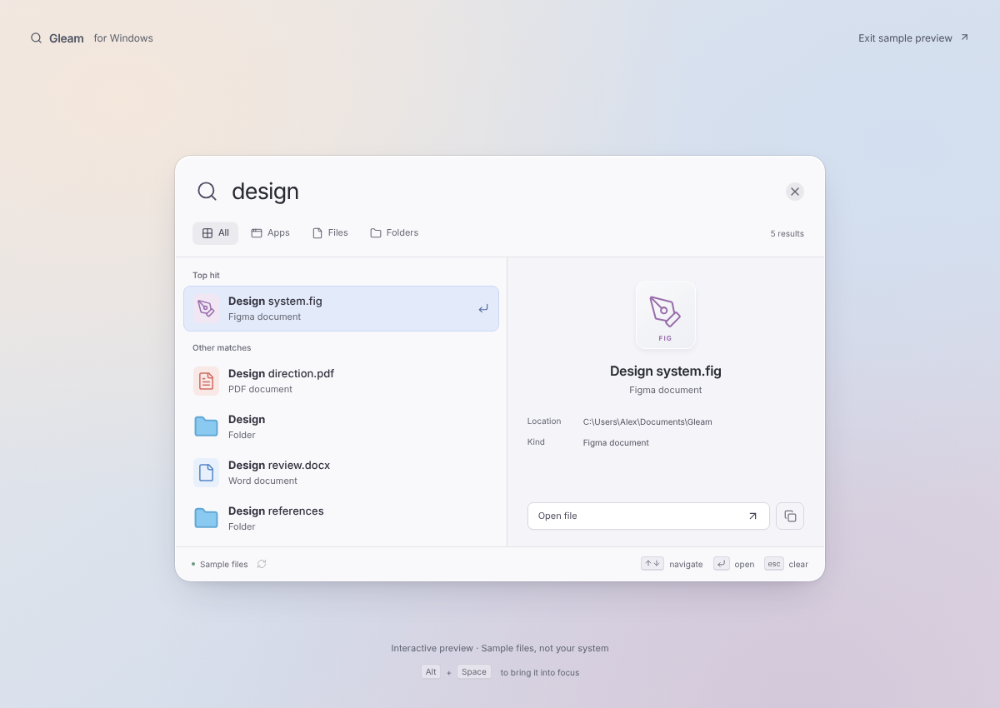

# Gleam

[](https://github.com/PerspicaciousGuy/gleam/actions/workflows/windows.yml)

A fast, local file and app launcher for Windows, built with **Rust, Tauri 2, React and TypeScript**. Press **Alt + Space**, type a name, press **Enter**.



*The screenshot is the browser preview with labelled sample files. The Windows app searches your own drives.*

## Features

- Searches the **names** of files, folders, apps and Start Menu shortcuts, including Microsoft Store apps, from a local SQLite index.
- Results as you type, ranked so that apps come first and names that start with your text come before names that merely contain it.
- Real app icons, a details pane with the full location, and a copy-path button.
- Slash commands (`/a`, `/f`, `/o`, `/r`) and a list of recent searches, all from the keyboard.
- Optional Windows Acrylic blur, switchable from the tray menu.
- No network access and no telemetry in Gleam's own code. See [Privacy and data](#privacy-and-data).

## Status

Gleam is an early release (0.x). It is developed and tested on Windows 11 by one person, and nothing here has been verified on Windows 10. Expect rough edges, and see [what is not implemented yet](#search-behavior-and-scope). Bug reports are welcome.

## Install

### Download the installer

1. Open the [latest release](https://github.com/PerspicaciousGuy/gleam/releases/latest) and download `Gleam_<version>_x64-setup.exe`.
2. Run it. It installs for the current user only, so it should not ask for administrator rights.
3. The installer is **not code-signed**, so Windows SmartScreen shows "Windows protected your PC". Choose **More info**, then **Run anyway** if you trust the download.
4. To check the file first, compare its hash with `SHA256SUMS.txt` on the release page:

   ```powershell
   Get-FileHash .\Gleam_<version>_x64-setup.exe -Algorithm SHA256
   ```

Requirements: 64-bit Windows with the [Microsoft Edge WebView2 Runtime](https://developer.microsoft.com/en-us/microsoft-edge/webview2/), which Windows 10 and 11 normally include. Uninstall from **Settings > Apps**.

### Build from source

Install:

- [Node.js LTS](https://nodejs.org/)
- [Rust through rustup](https://rustup.rs/) using the default MSVC toolchain
- [Visual Studio Build Tools](https://visualstudio.microsoft.com/visual-cpp-build-tools/) with **Desktop development with C++** and a Windows SDK
- WebView2 Runtime, as above

Then, in PowerShell:

```powershell
git clone https://github.com/PerspicaciousGuy/gleam.git
cd gleam
npm ci
npm run desktop   # run the app in development mode
npm run bundle    # or build the installer under src-tauri/target/release/bundle/nsis/
```

## Using Gleam

The first launch starts indexing in the background. Results appear as batches are saved. A full drive scan can take a while and the footer shows progress. Later launches can search the saved index while it refreshes.

- **Alt + Space:** show/hide the launcher
- **Up / Down:** select a result
- **Enter:** open with its Windows default application
- **Escape:** clear the search; press again to hide the launcher
- **Ctrl + 1 / 2 / 3 / 4:** switch All / Apps / Files / Folders
- **Ctrl + L:** select the search field
- **Slash commands:** type `/a ` for Apps, `/f ` for Files, or `/o ` for Folders. The prefix becomes a chip in the search box; Backspace on an empty box removes it, and Esc clears the text and the chip. Type `/` alone to list the commands (Up/Down, then Enter or Tab), or `/r` to show recent searches.
- **Recent searches:** with an empty box, Gleam lists your last 10 searches (saved when you open a result, or when the launcher loses focus while results are showing). Select one with Up/Down and Enter, or click it. **Clear** erases the list. They are stored as plain text in the WebView's local storage on your PC, not in the file index.
- **Tray menu:** open, refresh the index, toggle the blur background, or quit
- **Refresh button:** rescan for new, renamed, or removed files

Alt + Space must be available to register as a global shortcut. If another utility owns it, use the tray menu to open Gleam. Closing the window keeps the process running; use **Quit Gleam** in the tray menu to exit.

## Privacy and data

Gleam runs entirely on your PC. Its own code contains no network requests and no telemetry, and its content security policy allows only local connections. The Microsoft WebView2 runtime that draws the window is a separate Microsoft component that Gleam does not control.

What Gleam stores, all unencrypted, in per-user folders (Tauri's app data directory for the identifier `io.github.perspicaciousguy.gleam`, and the WebView2 profile for the same identifier):

- **The file index** (`index.sqlite3`): the name and full path of every file and folder Gleam could read on your drive letters, including paths you may consider private. Anyone who can read your user profile can read it.
- **Recent searches**: up to 10 query texts, in the WebView's local storage. **Clear** in the recent list erases them.
- **An icon cache** (`icons/`), and an empty marker file (`blur-off`) while the blur is switched off.

What Gleam runs: a hidden `powershell.exe` with `Get-StartApps` on each refresh (to list Microsoft Store apps), `explorer.exe` to launch those apps, and your default handler for opening files. File contents are never read.

To remove everything, uninstall Gleam and delete its data folders. The installer's own options may handle some of this; check that they are gone.

## Performance comes first

Search runs in Rust against a persistent SQLite index. The UI dispatches immediately with one request in flight and only the latest query pending. Search/status updates pause while the launcher is hidden or unfocused; the Rust indexer can continue its background scan. The surface uses a mostly solid fill; there is no CSS backdrop blur. An experimental native Windows Acrylic blur can be switched off from the tray menu (**Blur background**); see [PERFORMANCE.md](PERFORMANCE.md#acrylic-blur-experiment).

See [performance measurements and remaining work](PERFORMANCE.md). The one-million-entry synthetic Linux benchmark reduced backend p95 from approximately 358 ms to under 1 ms; this is not a Windows end-to-end timing or memory measurement.

## Interface

The launcher opens as a compact search field with category controls. Typing expands it into a results list and a details pane showing the selected item's type and location. Use the copy button to copy its full path. These are filename details; document contents are not read or previewed.

For a browser preview, run `npm run dev`, then open `http://localhost:1420`. Choose **Explore sample files** (or visit `http://localhost:1420/?demo=1`) to try search, filtering, navigation, and copying paths with labeled fixtures. Browser previews do not access your filesystem. The background and preview labels only appear in the browser; the native launcher floats above your Windows desktop.

See [design notes](design/notes.md) and [the updated preview](preview.png). Native window resizing and transparency require Windows validation.

## App icons

Apps in the results list show their real Windows icon. The shell is asked for it about 120 ms after a row appears (never for every one of the 40 results at once), at most three at a time, and the PNG is cached in the app data folder under `icons`, keyed by path, size and file modification time. Until it arrives, or if Windows has none, the generic icon is shown. Store/MSIX apps are requested through `shell:AppsFolder\<ID>`. Files and folders keep their generic icons, and the details pane keeps its large generic icon. The extraction code is Windows-only (`src-tauri/src/icons.rs`); the browser preview shows clearly fake letter tiles instead.

## Search behavior and scope

- Searches **names**, not file contents. Includes files, folders, `.exe` apps, and `.lnk`/`.appref-ms` shortcuts, including indexed Start Menu shortcuts.
- Store/MSIX apps (for example the TradingView desktop app) cannot be found by walking the disk, because `C:\Program Files\WindowsApps` is not listable by standard users and their Start Menu entries are not `.lnk` files. Each refresh runs `Get-StartApps` in a hidden PowerShell and indexes the packaged apps (those with a `Package!App` ID) as Apps; they open through `explorer.exe shell:AppsFolder\<ID>`. This adds a PowerShell start-up (about a second or more) to every refresh, on the indexer thread.
- Scans accessible mounted drive letters A–Z under your current Windows account. Network/removable drives with letters may be included and may slow indexing. It does not bypass permissions or fetch online-only file contents.
- Does not follow symbolic links or directory junctions. Skips `.git`, `node_modules`, `$Recycle.Bin`, and `System Volume Information` directories.
- Uses a local SQLite FTS5 trigram index for substring matches with **three or more characters**. One- and two-character queries match the beginning of a name. Results rank in tiers: names that start with your text, then names that contain it. Within each tier, apps come before files and folders (so a name shared by many folders cannot push an app off the list). Prefix matches are in case-insensitive name order and substring matches in stable index order. Every tier reads an index in order, so the search stops after filling 40 results.
- Index lives in Tauri's per-user application data directory as `index.sqlite3`. It contains filenames and paths. No network search or telemetry is included.
- Refreshes on startup and manually. **Live filesystem watching, launch at login, settings search, file-content search, and shortcut customization are not implemented yet.** Failed scans retain saved entries; unreadable paths are counted and skipped. A completed refresh removes entries not seen during that scan.

## Development checks

```sh
npm run build
cargo test --manifest-path src-tauri/Cargo.toml --lib
cargo check --manifest-path src-tauri/Cargo.toml --features desktop
```

The core Rust tests run without a GUI toolchain. The desktop check requires the platform's Tauri prerequisites. `npm run dev` also provides a browser preview, clearly labeled as a preview, without access to system files. Native shortcuts, tray interaction, opening results, and installer behavior must be tested on Windows.

## Contributing

Issues and pull requests are welcome. Please read [CONTRIBUTING.md](CONTRIBUTING.md) first. For security problems, see [SECURITY.md](SECURITY.md) instead of opening a public issue. Notable changes are listed in [CHANGELOG.md](CHANGELOG.md).

## License

[MIT](LICENSE) © 2026 PerspicaciousGuy. The Apple Spotlight interface was a design reference only; Gleam is an independent project and is not affiliated with or endorsed by Apple.
